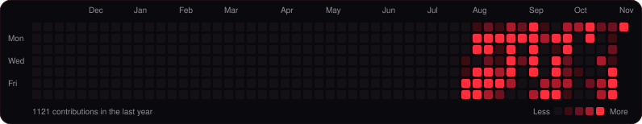

  

  

  
  
  
  
  
  

## 01 / whoami

I build Android apps, Kotlin Multiplatform tools, AI agents and the occasional privacy or security utility — usually offline-first, often at night.

- **Focus** — Android · Kotlin Multiplatform · on-device AI agents · security & privacy tooling
- **Now** — shipping [NOIR](https://github.com/Verlintas/NOIR) (Android privacy audit over adb) and [NovaBAIC](https://github.com/Verlintas/NovaBAIC) (local-first agent)
- **Principles** — no accounts, no telemetry, no GMS where avoidable; keep the data on the device
- **Org** — main developer at [NUSV](https://github.com/NUSV), open-source Android apps, tools and games
- **Languages** — 中文 / English

## 02 / stack

## 03 / selected work

  <a href="https://github.com/Verlintas/NOIR">NOIR</a> ·
  <a href="https://github.com/Verlintas/BetterAIChat">BetterAIChat</a> ·
  <a href="https://github.com/Verlintas/NovaBAIC">NovaBAIC</a> ·
  <a href="https://github.com/NUSV/Syna-NUSV">Syna-NUSV</a> ·
  <a href="https://github.com/Verlintas/OpenVisum">OpenVisum</a> ·
  <a href="https://github.com/Verlintas/VerlinPark">VerlinPark</a>
   
  <a href="https://github.com/Verlintas?tab=repositories">all repositories →</a>

## 04 / signals

  

  

  Just for fun. — Linus Torvalds

